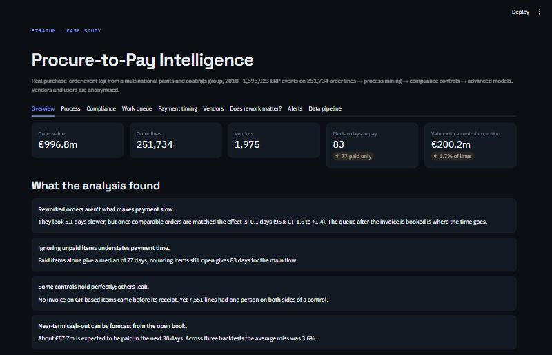
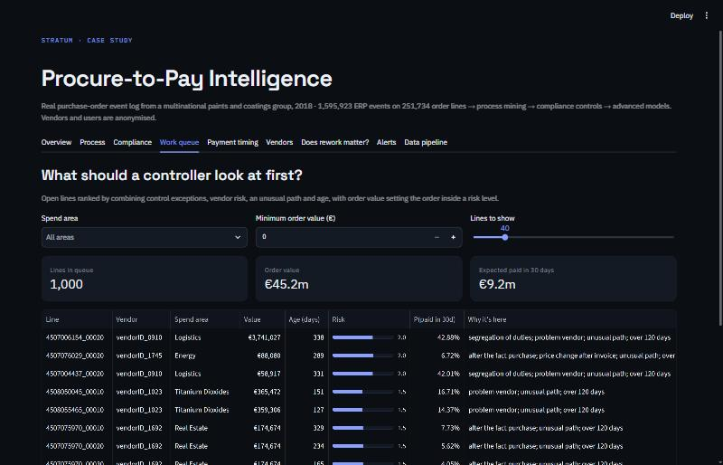

# Procure-to-Pay Intelligence

**What 1.6 million ERP events reveal about how a company really buys and pays.**

*A [Stratum](https://stratumdata.org) case study · process mining · compliance analytics · causal inference · machine learning*

**[▶ Try the live dashboard](https://p2p-intelligence-5wdy2r5plrdmd89mf49tqg.streamlit.app/)** · **[Read the case study (PDF)](presentation/Procure-to-Pay-Intelligence-Stratum.pdf)**



---

## The brief

A multinational coatings and paints group runs its purchasing through an ERP. Every order, goods receipt, invoice and payment leaves a timestamped trace: **1,595,923 events** on **251,734 order lines**, across 76,349 purchase orders, 1,975 vendors and €997M of orders in 2018.

Its process owner had compliance questions. This project asks four, of the kind a finance leader cares about:

1. **What really happens** between ordering and paying?
2. **Where do controls fail**, and how much money sits behind each failure?
3. **When does cash go out**, and how sure can we be?
4. **What actually causes delay**, as opposed to what merely travels with it?

The data is the public [BPI Challenge 2019](https://doi.org/10.4121/uuid:d06aff4b-79f0-45e6-8ec8-e19730c248f1) event log (van Dongen, 4TU.ResearchData, CC BY 4.0). It's real, and vendors and users are anonymised.

## What the analysis found

| Question | Answer | How we know |
|---|---|---|
| What causes delay? | **Not order changes.** Changed orders look 5.1 days slower, but the adjusted effect is −0.1 days (95% CI −1.6 to +1.4). Cutting rework is unlikely to speed up payment | Double machine learning on a landmark cohort of 108,383 lines, with a shuffled-treatment placebo |
| Where's the time? | **After the invoice is booked.** That single step holds about 3.5× the waiting of any other. It may reflect payment terms, which the log doesn't record | Process mining; 84% of paid lines in the main flow ran straight through |
| Where do controls fail? | **16,799 lines (6.7%) and €200M of order value carry an exception.** 7,551 lines had one person on both sides of a control. Three of ten controls had no exceptions | Ten rules tested on every line, with a dbt unit test on the rule logic |
| When does cash go out? | **About €67.7M in the next 30 days.** Average backtest miss 3.6%, against 5.9% for repeating the last 30 days | Survival model forecasting open items, using only data known at each date |
| Which vendors are a problem? | **Not the ones a league table names.** The raw top 20 has a median of 1 line; the Bayesian top 20 has 55. Only 1 vendor is on both lists | Hierarchical Bayes, which predicts each vendor's second half better than raw rates |

## The finding that shaped everything

The source field `Cumulative net worth (EUR)` looks like a document amount. It isn't: it's the line's running value, repeated on every event. A first version summed it and reported about **€5.7B** against a **€997M** order book. Reconciling to a known total caught the error.

So value-based three-way matching isn't possible on this data. Controls test document *counts*, exposure always uses order value, and the limit is stated rather than hidden.

## What's in the project

```
XES log ──stream──▶ Bronze parquet ──dbt──▶ Star schema ──▶ 31 dbt tests
730 MB               checksummed            on DuckDB            │ a failure stops the build
                                                                 ▼
 Streamlit work queue ◀── serving layer ◀── process mining · compliance · models
```

### Data engineering → [`src/p2p/extract.py`](src/p2p/extract.py), [`dbt/`](dbt)
* The 730 MB XML log is **stream-parsed** in about 30 seconds with flat memory, checksum verified, and with external entities disabled because it's outside data.
* A proper **dbt project** with staging, intermediate and mart layers: line, document and event grains, plus vendor, user, activity and date dimensions.
* **31 tests**: keys, relationships, accepted values, reconciliation back to the source, and a unit test feeding the compliance rules known good and bad lines.
* Implausible dates (some as early as 1948) are flagged rather than dropped. Items unfinished at the 18 January 2019 cutoff are treated as censored, not missing.

### Analysis → [`01_event_log_and_process.ipynb`](notebooks/01_event_log_and_process.ipynb), [`02_advanced_models.ipynb`](notebooks/02_advanced_models.ipynb)

| Technique | Question | Validated against | Result |
|---|---|---|---|
| **Process mining** (pm4py inductive miner) | What really happens? | Replay on sampled behaviour | Fitness 0.96 on the main flow, 0.68 on the GR-based flow |
| **Survival analysis** (AFT models) | How long will payment take? | Flow median, later items | Concordance 0.82 vs 0.51 |
| **Double machine learning** | Does rework cause delay? | Naive gap, placebo | 5.1 days falls to −0.1 |
| **Hierarchical Bayes** (NumPyro) | Which vendors are really worse? | Raw and overall rates, next half-year | Log score −0.224 vs −0.294 and −0.240 |
| **Conformal prediction** | Do ranges keep their promise? | Raw quantile model, later items | Coverage 79% raised to 92% (target 90%) |
| **GRU sequence model** (PyTorch) | What happens next, and how long is left? | 2nd-order Markov chain, median by position | 19.8 vs 24.2 days error; 79% vs 76% next step |
| **Anomaly detection** (Isolation Forest) | Which items look wrong? | Control rules it never saw | 58% precision in the top 500, against a 7% base rate |
| **Cost-based decisions** | Is a review worth it? | Reviewing everything or nothing | Best to review 4.2% of invoices, under stated assumptions |

### What didn't work, or needs care

* **The cash forecast isn't always better.** Repeating the last 30 days beat it on one of three backtest dates, and the log-logistic model that ranks items best was a poor cash forecaster. The model was therefore chosen on a separate date.
* **Conformal coverage isn't perfect.** The smaller flow reaches 88%, and ranges are 105 days wide. Time drift weakens the guarantee, so a deployed version should recalibrate on a rolling window.
* **Alerts only just pay.** With a €10 review, €180 correction and half prevented, the best saving is about €15k over the test period. At €25 a review it falls to about €5k on 0.8% of invoices. These costs are assumptions, not data, and the dashboard lets you change them.
* **The causal result assumes no major hidden confounder.** Packaging shows a small positive effect (+3.1 days, CI 1.3 to 4.9), but segment results weren't pre-specified, so treat that as a lead.
* **Exceptions aren't wrongdoing.** Each one is a prompt to review.
* **Payment terms aren't in the log**, which limits what can be said about the wait after an invoice is booked.

### Dashboard → [`dashboard/app.py`](dashboard/app.py)



Nine tabs, built around action:

* **Work queue:** open lines ranked by control exceptions, vendor risk, unusual path and age, with the reason each line is there, and a CSV download
* **Process:** flow map, waiting time, and who does the work
* **Compliance:** exposure by control, the controls that held, and repeat users
* **Payment timing:** survival curves, cash forecast backtest, conformal ranges, live prediction
* **Vendors:** Bayesian league table with intervals, and a vendor lookup
* **Does rework matter?:** naive gap against adjusted effect, with the checks
* **Alerts:** a cost simulator using your own numbers
* **Overview** and **Data pipeline**

It reads only a 0.5 MB serving layer of parquet files (committed), so it deploys without the warehouse.

## Run it

Requires Python 3.11 or 3.12 and [uv](https://docs.astral.sh/uv/).

```bash
uv sync
uv run p2p all                          # download, dbt build and tests, analysis, export (~10 min)
uv run streamlit run dashboard/app.py   # http://localhost:8501
uv run pytest                           # model correctness, parsing and dashboard tests
uv run python scripts/build_notebooks.py
```

`p2p analyse --skip-slow` skips process replay and the sequence model. Dashboard only: deploy `dashboard/app.py` on Streamlit Community Cloud with `dashboard/requirements.txt`.

## Stack

Python · SQL · dbt · DuckDB · pm4py · lifelines · NumPyro · PyTorch · scikit-learn · SciPy · Plotly · Streamlit · pytest · GitHub Actions

---

*Data: van Dongen, B.F. (2019), BPI Challenge 2019, 4TU.ResearchData, CC BY 4.0.*

*Built by [Stratum](https://stratumdata.org), an independent data science and engineering practice. What's your ERP not telling you? [stratumfreelance@gmail.com](mailto:stratumfreelance@gmail.com)*
